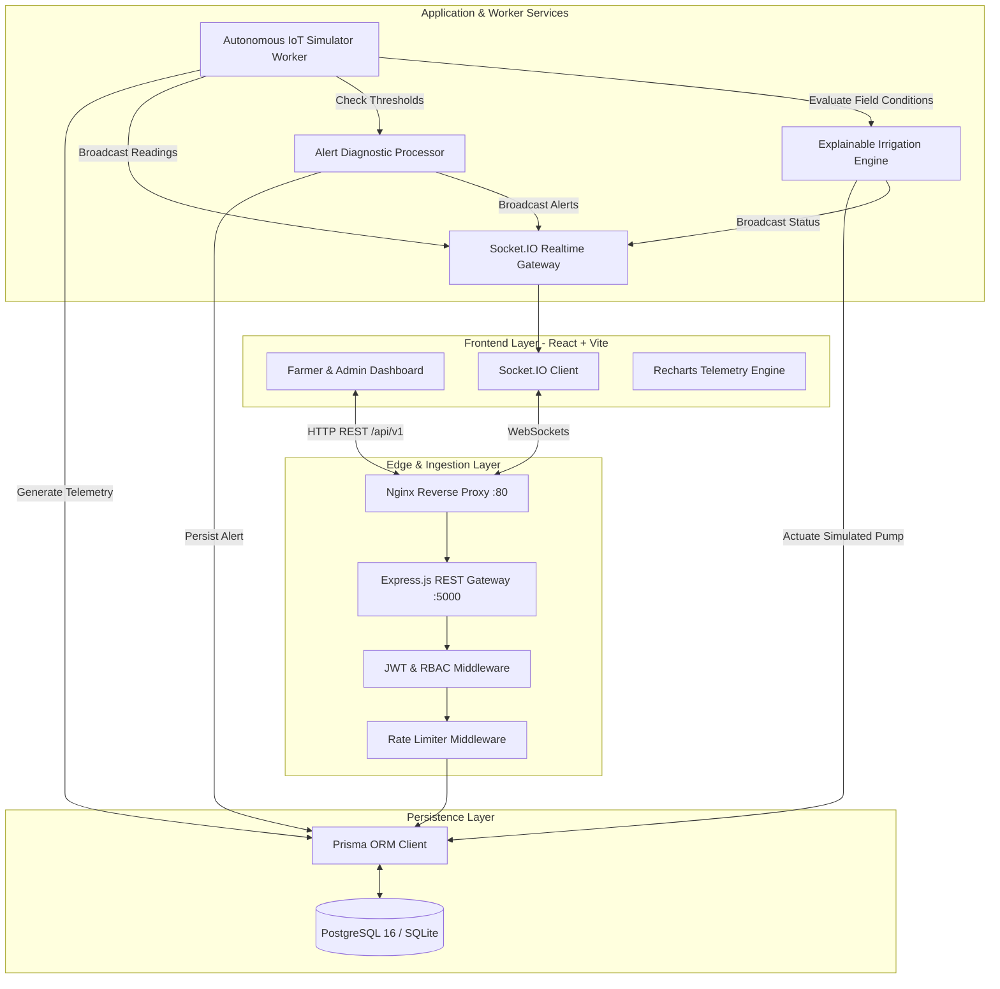
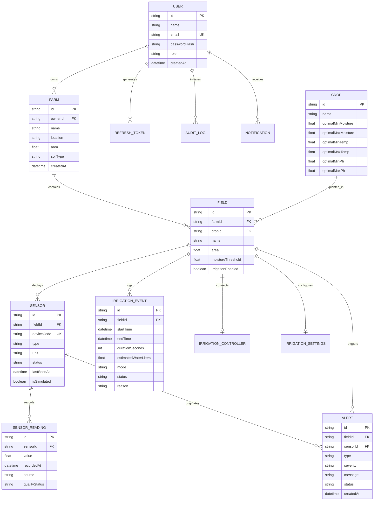
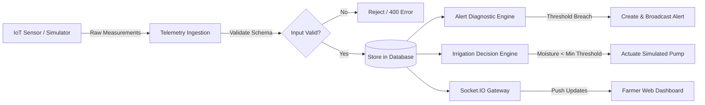

# AgriCloud — Cloud-Based Smart Agriculture Monitoring and Irrigation Management System

[](https://github.com/agricloud/agricloud/actions/workflows/ci.yml)
[](https://nodejs.org/)
[](https://www.typescriptlang.org/)
[](LICENSE)

---

## 1. Project Abstract

**AgriCloud** is a production-style, cloud-connected agricultural Internet of Things (IoT) monitoring and precision irrigation management platform. The system bridges physical and simulated agronomic field sensors with scalable cloud infrastructure. It continuously ingests multi-sensor telemetry—including soil moisture (%), ambient temperature (°C), relative humidity (%), rainfall precipitation (mm), and soil pH—evaluates readings against deterministic crop-specific agronomic models, orchestrates precision irrigation pumps, and notifies agricultural operators in real time. 

When physical hardware sensors are disconnected or unavailable during laboratory evaluation, an autonomous **Cyber-Physical IoT Simulation Subsystem** generates realistic diurnal microclimatic curves, progressive soil moisture depletion, and precipitation events, providing an end-to-end operational platform out of the box.

---

## 2. Problem Statement

Traditional agriculture suffers from substantial resource waste, unpredictable crop losses, and manual oversight inefficiencies:
1. **Irrigation Inefficiency**: Over-irrigation causes excessive water runoff, soil nutrient leaching, and high electricity bills; under-irrigation creates water stress, stunting crop development.
2. **Lack of Explainability**: Many agricultural automation systems operate as "black boxes" without providing farmers with clear reasons why an irrigation valve was actuated.
3. **Data Silos & Stale Readings**: Farmers frequently lack centralized dashboards, resulting in delayed responses to abnormal soil pH, extreme midday heat, or sensor hardware failures.
4. **Hardware Dependency in Testing**: Academic and prototyping evaluations frequently stall due to the absence of physical sensor nodes or unstable wireless links.

---

## 3. Proposed Solution & Key Objectives

AgriCloud provides an integrated, 4-tier cloud platform designed to solve these challenges:
- **Comprehensive Sensing**: Multi-parameter monitoring across soil moisture, temperature, humidity, rainfall, and pH.
- **Closed-Loop Cyber-Physical Simulator**: Plausible microclimatic diurnal variations, rainfall events, and simulated pump water delivery.
- **Explainable Irrigation Decision Engine**: Deterministic rules that evaluate current root-zone moisture, crop-specific bounds, recent rainfall delays, pump cooldowns, and safety run limits.
- **Multi-Role Governance**: Role-based access control (RBAC) isolating resources between Administrators, Farmers, and Viewers.
- **Cloud-Native Deployment**: Monorepo architecture supporting Docker Compose multi-container deployment, managed PostgreSQL cloud databases (AWS RDS, Neon, Supabase), and zero-config local SQLite fallback.

---

## 4. Technology Stack & Justification

| Layer | Technologies | Justification |
|---|---|---|
| **Frontend UI** | React 18, Vite, TypeScript | High-performance SPA with fast development HMR and strict type safety |
| **Styling** | Tailwind CSS, Lucide Icons | Clean, responsive emerald/slate theme without yellow backgrounds |
| **Visualizations** | Recharts | Responsive SVG charts for multi-sensor time-series curves |
| **Server State** | TanStack Query | Cached server queries, deduplication, and background invalidation |
| **Forms & Validation** | React Hook Form, Zod | Type-safe declarative schema validation |
| **Realtime WebSockets**| Socket.IO Client & Server | Instant bi-directional telemetry broadcast with polling fallback |
| **Backend Runtime** | Node.js (v20+ / v26), Express.js | Event-driven non-blocking I/O ideal for concurrent IoT telemetry streams |
| **Database & ORM** | PostgreSQL 16 & Prisma ORM | Relational schema integrity, migrations, foreign key cascades, and time-series composite indexes |
| **Local Fallback DB** | SQLite (`agricloud.db`) | Turnkey zero-dependency local setup without requiring a pre-installed database server |
| **Authentication** | JWT (Argon2 / bcryptjs) | Stateless Short-Lived Access Tokens (15m) + Persistent Refresh Tokens (7d) |
| **DevOps & Cloud** | Docker, Docker Compose, Nginx | Multi-stage container builds, automated reverse proxying, and cloud portability |
| **Testing** | Vitest, Supertest | Rapid unit and integration testing of irrigation rules and API endpoints |

---

## 5. System Architecture Diagram



---

## 6. Database Entity-Relationship Diagram



---

## 7. Data-Flow Diagram (DFD Level 1)



---

## 8. Development Setup & Quick Start

### Prerequisites
- **Node.js**: v20.x or v26.x
- **npm**: v10.x or v11.x
- Windows PowerShell, macOS Terminal, or Linux Bash

### Step 1: Install Monorepo Dependencies
From the repository root:
```bash
npm install
```

### Step 2: Initialize Database & Seed Demo Data
AgriCloud is configured with zero-dependency SQLite by default (`file:./agricloud.db`):
```bash
# Push schema tables and create indexes
npm run db:push

# Seed demo users, crops, farms, sensors, and 350+ historical readings
npm run db:seed
```

### Step 3: Launch Local Development Servers
Run backend API and frontend Vite SPA concurrently:
```bash
npm run dev
```
- **Frontend Dashboard**: `http://localhost:5173`
- **Backend REST API**: `http://localhost:5000/api/v1`
- **Interactive Swagger Documentation**: `http://localhost:5000/api-docs`
- **Health Check Endpoint**: `http://localhost:5000/health`
- **Readiness Check Endpoint**: `http://localhost:5000/ready`

---

## 9. Development Demo Credentials

| Role | Email | Password | Access Scope |
|---|---|---|---|
| **Farmer** | `farmer@agricloud.io` | `Password123!` | Full control over own farms, fields, manual/auto irrigation, alerts |
| **Administrator** | `admin@agricloud.io` | `Password123!` | System metrics, user role management, simulator controls, audit trail |
| **Viewer** | `viewer@agricloud.io` | `Password123!` | Read-only analytics, telemetry charts, historical irrigation events |

*(Note: These credentials are strictly intended for local demonstration and academic evaluation. Change all secrets prior to production deployment.)*

---

## 10. Automated Testing

The test suite validates the deterministic rule engine, safety limits, authentication, RBAC, and telemetry ingestion:
```bash
npm run test
```
**Test Results**:
- `tests/irrigationEngine.test.ts` (7 passed):
  - Triggers START on moisture depletion
  - Stops pump when target moisture is reached
  - Enforces maximum safe runtime safety cutoff
  - Postpones watering upon rainfall detection
  - Enforces pump cooldown period
  - Refuses auto-actuation when sensor readings are stale
- `tests/api.test.ts` (9 passed):
  - Health check verification
  - Farmer & Admin authentication
  - User profile resolution
  - Resource ownership isolation
  - Telemetry ingestion validation
  - Role-based authorization enforcement

---

## 11. Docker & Container Deployment

To launch the multi-container stack with managed PostgreSQL:
```bash
docker compose up -d --build
```
This provisions:
- `agricloud-postgres`: PostgreSQL 16 Alpine on port `5432` with persistent volumes
- `agricloud-api`: Node.js container on port `5000`
- `agricloud-web`: Nginx container on port `80` with SPA routing and WebSocket proxying

---

## 12. Cloud Deployment Guide

### Free-Tier Cloud Deployment (Neon + Render/Railway)
1. Provision a free PostgreSQL database on [Neon.tech](https://neon.tech).
2. Connect your repository to [Render](https://render.com) or [Railway](https://railway.app).
3. Set `DATABASE_URL` to your Neon connection string.
4. Deploy the backend API using `npm ci && npm run build --workspace=packages/shared && npx prisma generate --schema=prisma/schema.postgresql.prisma && npm run build --workspace=apps/api`.
5. Deploy the frontend on Render or Vercel pointing to `apps/web/dist`.

---

## 13. Academic Assessment Report: Cloud Computing Concepts

### A. Abstract
Modern agriculture faces escalating water scarcity and climatic volatility. AgriCloud provides an end-to-end cloud solution incorporating microservices, real-time event streaming, role-based security, and explainable decision algorithms.

### B. Cloud Computing Concepts Demonstrated
1. **Stateless Compute**: API instances maintain no process-bound session state, allowing seamless scaling behind a round-robin load balancer.
2. **Managed Persistence**: Separation of application runtime and relational database storage.
3. **Asynchronous Background Processing**: Decoupling long-running IoT telemetry generation and threshold scanning from user-facing HTTP transactions.
4. **Resilient Health Probing**: Container orchestration compatibility via `/health` (liveness) and `/ready` (readiness checking database ping).
5. **Security Isolation & Governance**: JWT token rotation, cryptographic password hashing (bcrypt), and role-based access control.

---

## 14. Project Directory Structure

```
agricloud/
├── apps/
│   ├── api/
│   │   ├── src/
│   │   │   ├── config/          # Environment & Prisma client instances
│   │   │   ├── jobs/            # IoT simulator, Alert processor, Irrigation engine
│   │   │   ├── middleware/      # Auth, RBAC, Rate limiter, Logger, Error handler
│   │   │   ├── modules/         # Auth, Farms, Fields, Crops, Sensors, Readings, Irrigation, Alerts, Analytics, Admin
│   │   │   ├── realtime/        # Socket.IO gateway & event broadcasters
│   │   │   ├── app.ts           # Express application factory
│   │   │   ├── index.ts         # Server startup & graceful shutdown
│   │   │   └── swagger.ts       # OpenAPI 3.0 specification
│   │   ├── tests/               # Vitest rule and API integration tests
│   │   ├── Dockerfile
│   │   └── package.json
│   └── web/
│       ├── src/
│       │   ├── components/      # Navbar, Sidebar, Badges, ConfirmDialog
│       │   ├── context/         # AuthContext, RealtimeContext
│       │   ├── layouts/         # AppLayout
│       │   ├── pages/           # Landing, Login, Register, Dashboard, Farms, Fields, Sensors, Live, Irrigation, Alerts, Analytics, Admin, Settings
│       │   ├── services/        # Fetch API client & Socket.IO client
│       │   ├── types/           # Shared TypeScript interfaces
│       │   ├── App.tsx          # React Router hierarchy
│       │   ├── main.tsx         # React DOM mount
│       │   └── index.css        # Tailwind styling & custom scrollbars
│       ├── Dockerfile
│       ├── nginx.conf
│       └── package.json
├── packages/
│   └── shared/                  # Shared Zod schemas, enums, DTOs
├── prisma/
│   ├── schema.prisma            # Active database schema (SQLite zero-config)
│   ├── schema.postgresql.prisma # Production PostgreSQL schema
│   └── seed.ts                  # Comprehensive database seed script
├── docs/                        # Architecture, API, Database, Deployment, User Guide
├── .github/workflows/ci.yml     # GitHub Actions pipeline
├── docker-compose.yml           # Multi-container production deployment
├── .env.example                 # Configuration template
├── .gitignore
└── README.md
```

---

## 15. Limitations and Future Scope
- **Physical Hardware Gateway**: While the API supports physical ESP32 HTTP ingestion via `POST /readings/ingest`, direct MQTT broker integration (e.g. EMQX / Mosquitto) can be incorporated in future iterations.
- **Machine Learning Yield Prediction**: Future integration of LSTM or Random Forest models to forecast optimal planting and harvest dates based on historical microclimate records.
- **Satellite Imaging & NDVI**: Integration of Sentinel-2 satellite imagery for remote vegetative index monitoring.
