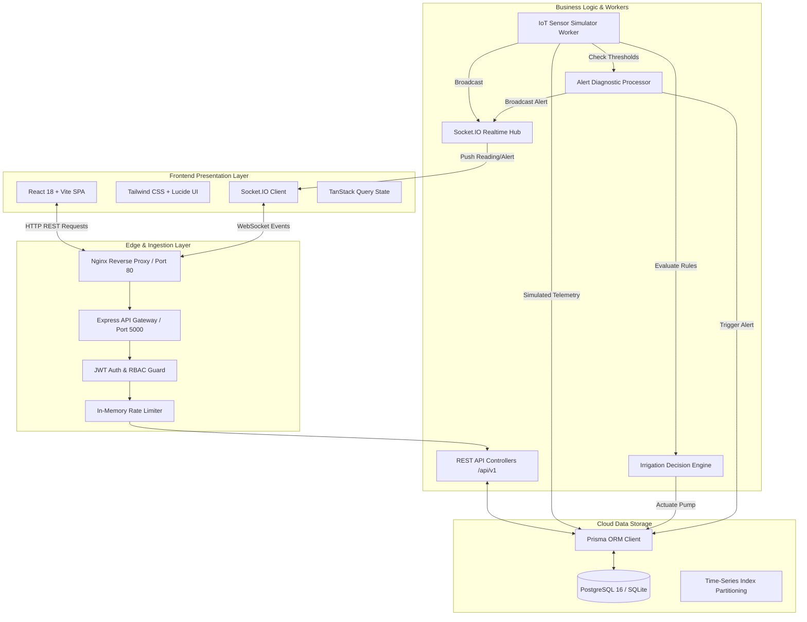
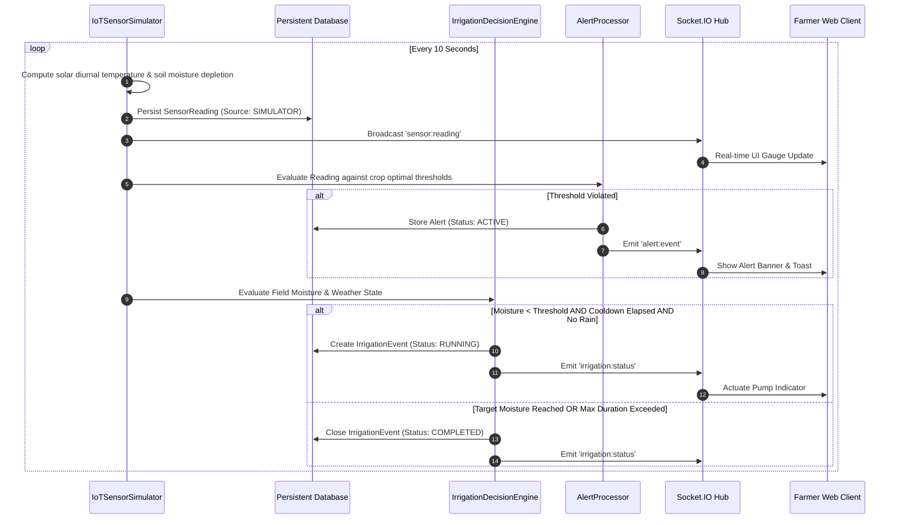

# AgriCloud — System Architecture Documentation

## 1. Executive Summary

AgriCloud is a cloud-native precision agriculture and smart irrigation management platform. The system ingests environmental telemetry (soil moisture, ambient temperature, relative humidity, precipitation, and soil pH), analyzes values against crop-specific agronomic models, evaluates deterministic irrigation rules, and orchestrates simulated precision pumps.

## 2. Multi-Tier System Topology

## 3. Cyber-Physical IoT Simulation Feedback Loop

When physical ESP32/Arduino microcontroller probes are offline or during academic evaluation, the system executes an autonomous background simulation worker:

## 4. Cloud Computing Principles Demonstrated

1. **Horizontal Scalability**: Stateless Express.js API design allowing multiple container instances behind a load balancer.
2. **Persistence Isolation**: Relational database (PostgreSQL/SQLite) isolated from application compute memory.
3. **Decoupled Asynchronous Workers**: IoT simulation and threshold evaluation run as autonomous workers without blocking client HTTP request lifecycles.
4. **Environment-Driven Configuration**: 12-factor configuration using environment variables for port, secrets, and connection strings.
5. **Observability & Health Probes**: Dedicated `/health` (liveness) and `/ready` (readiness checking database ping) endpoints.
