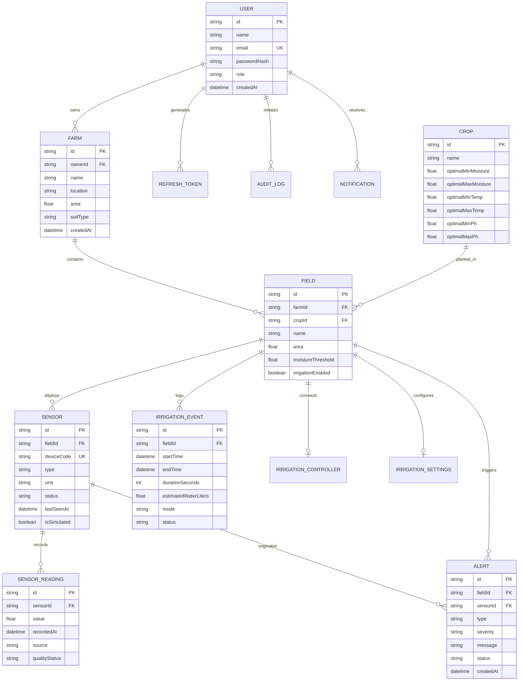

# AgriCloud — Database Design & Entity Relationship

## 1. Overview

The AgriCloud relational database is modeled using Prisma ORM. It provides normalized entities with referential integrity, foreign key cascades, unique hardware device constraints, and optimized time-series composite indexes.

Dual database configurations are supported:
- **Local Development**: Zero-dependency SQLite file (`agricloud.db`).
- **Production / Cloud**: Managed PostgreSQL 16 (AWS RDS, Neon, Supabase, Docker Compose).

## 2. Entity-Relationship Diagram (ERD)

## 3. Database Indexes

1. `SensorReading(sensorId, recordedAt)`: Optimizes time-series queries for telemetry line charts.
2. `SensorReading(recordedAt)`: Optimizes historical data retention policies and batch aggregations.
3. `Alert(fieldId, status)`: Optimizes real-time dashboard alert badge lookups.
4. `IrrigationEvent(fieldId, startTime)`: Optimizes water consumption analytics queries.
